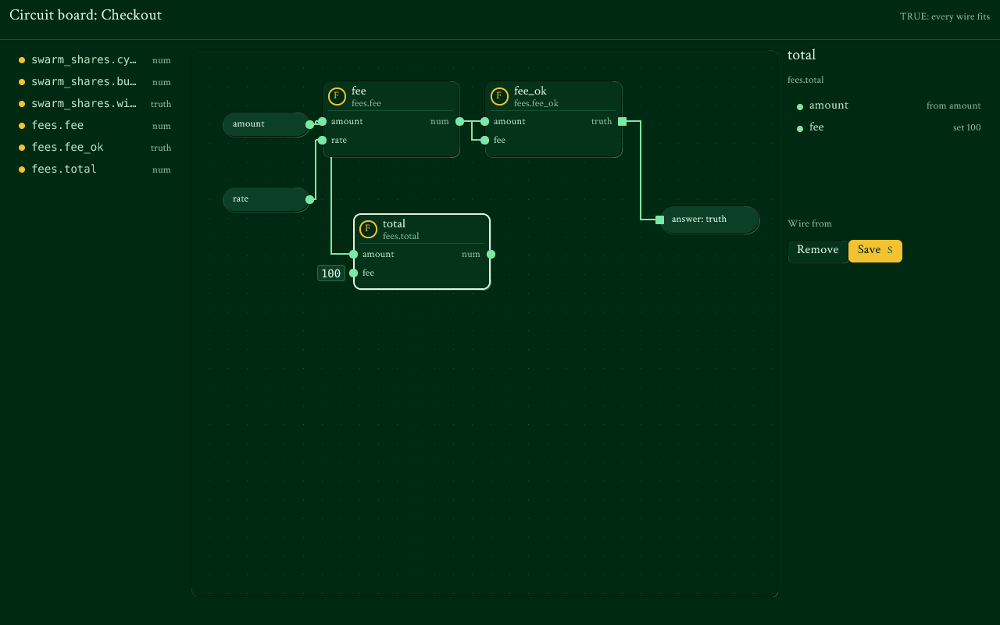
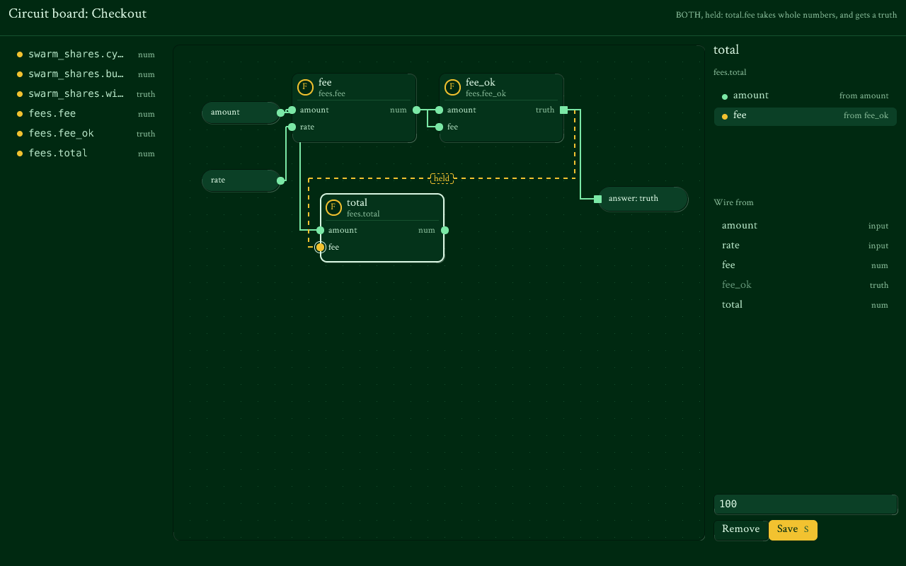

<!-- Copyright (c) 2024-2026 Michael Laurence Curzi and 36N9 Genetics, LLC -->
<!-- SPDX-License-Identifier: Apache-2.0 -->

# The Circuit board: building apps by wiring apps

A person builds a new ZXV app the way an engineer draws a circuit: they
take apps and blocks off a shelf, place them on a board, wire one app's
answer into another app's input, and set the knobs. Nobody writes code.
What they build is saved as an ordinary app manifest, so it runs, nests
inside bigger apps, is shared by content id and credits every part, the
same as an app written by hand.

This is how the 407 apps fit together: each L2 app is a board of L1 apps
(the catalogue's `built_from` column already lists its parts), and each
L3 app is a board of L2 apps. The same board is open to everyone.

## What the person sees



Three panes:

| Pane | What it is |
|---|---|
| Shelf (left) | Every entry an app or block lends, as `fees.fee`, with what it answers. Open a row to place it. |
| Board (middle) | The circuit. The app's own inputs sit on the left edge, its answer on the right, the parts between. |
| Inspector (right) | The picked part: its inputs, where each is wired from, a "Wire from" list and a field for a setting. Save is the one gold button. |

Each part is a carved tile with a vector badge, its name, what it is, its
inputs down the left edge and its answer on the right. Wiring is a drag
from an answer dot to an input dot; dragging a tile moves it. Everything
can also be done without a pointer (pick a part, pick an input, pick its
source), so the board works with a keyboard, a switch and the screen
reader.

## The logic, drawn

Every wire is drawn in its paraconsistent state, worked out fresh after
every change (`zxboard_check`):

| State | Drawn as | Means |
|---|---|---|
| TRUE | a solid green trace | whole numbers flow into an input that takes them |
| BOTH | a dashed gold trace tagged "held" | the wrong kind: a truth into a number input, an answer of the wrong kind, or a loop |
| NEITHER | a faint, empty dot | not wired yet, or its part is not on the shelf |

Round dots carry numbers, square dots carry truths. The status line says
the first problem in words ("total.fee takes whole numbers, and gets a
truth"). Nothing is ever converted or dropped to make a wire fit, and the
answer's kind is the person's choice, never changed to suit a wire.



The same rule holds when the app runs. Each part is called witnessed, so
a part whose languages disagree holds the whole circuit at that part, and
nothing downstream runs on a held answer. A fraction (1/3) arriving at a
whole-number input holds too. The circuit's own join is TRUE when every
part was witnessed by two languages, and NEITHER when any ran alone.

## What is saved

The board writes a manifest with one circuit, a `logic wire` entry
(`kernel/src/apps/zxwire.h`, W1 to W6):

```
zxapp 1
id checkout
name Checkout
version 1.0.0
view auto
use fees 1.2
provides fees.fee num amount rate
provides fees.fee_ok truth amount fee
provides main truth amount rate
logic wire main <<
part fee fees.fee amount=amount rate=rate
part fee_ok fees.fee_ok amount=amount fee=fee
out fee_ok
at amount 40 80
at rate 40 176
at fee 240 80
at fee_ok 480 80
at out 600 200
.
```

| Line | Meaning |
|---|---|
| `part <name> <entry> <input>=<source> ...` | A part, and where each of its inputs comes from: an input of the app, an earlier part, or a setting (`25`, `1,2,3`). A one-number setting is the same for every row. |
| `out <source>` | The app's answer. |
| `at <name> <x> <y>` | Where a part, an input or the answer sits on the board. Runs ignore it. |

Because it is an ordinary manifest:

- `view auto` gives the new app a working screen at once.
- The `provides` lines make it a block too, so the next person can put the
  whole board on their own board as one part. Circuits nest four deep.
- The manifest's content id names it; saving an unchanged board gives the
  same text and the same id (`zxboard_open` then `zxboard_save`).
- `zxapp_provenance` credits each part's author.
- An expert can open the text and edit it; the board reads it back.

A board is refused on save only when the app could not load: an unwired
input or a loop. A held wire saves, and holds when run, as the board said.

## Where it lives

| Piece | File |
|---|---|
| Circuits in manifests, the run, typed wires | `kernel/src/apps/zxwire.h`, `zxwire.c`; hooked into `zxapp.c` (`zxapp_wiring_t`) |
| The board model: shelf, edit, check, save, open, try | `kernel/src/apps/zxboard.h`, `zxboard.c` |
| The native screen | `kernel/src/zui/views/circuit.h`, `circuit.c` |
| Tests | `kernel/src/apps/test_zxapp.sh` (circuits and the board), `kernel/src/zui/views/test_views.sh` (the screen, driven by clicks and drags) |

The mockups above are the real renderer's output: run `test_views.sh`
with `ZXV_VIEWS_SHOTS` set to a folder and `ZXV_VIEWS_FONT` to the ASCW
Golden Latin font.

## Next

These are not built yet, in the order they would help most:

1. **A full shelf.** A part appears on the shelf when its app has
   `provides` lines. The built-in apps get theirs as their programs are
   written (the "Built-in apps and toolbox" waves); the shelf fills with
   no change here.
2. **The apps' own vector icons** on the tiles, in place of the initial
   in a ring, once the icon set is vector.
3. **Try on the screen.** The model can already run a board before it is
   kept (`zxboard_try`); the screen needs a panel for sample inputs.
4. **Richer wires.** Inputs carry whole-number vectors today, because
   that is all a contract describes. Text, records and files need typed
   inputs in `provides` first.
5. **Switches and several answers.** A part that runs only when a truth is
   TRUE, and boards with more than one `out`.
6. **Phone layout** (one pane at a time), zoom and pan for large boards,
   and undo.
7. **Suggested wiring** from the swarm, arriving held until the person
   accepts it, like every AI suggestion.

The board's pointer handling sits in the view (`cb_view_pointer`)
because the toolkit's canvas widget does not receive pointer events yet;
when zui routes them to canvases, the view will take them from there.
